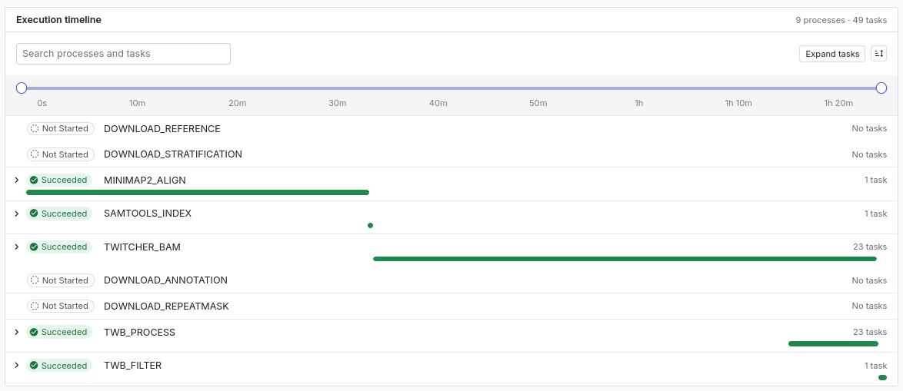

# Nextflow pipelines for Twitcher analyses

Twitcher and Twitcher Workbench are tools for identification and annotation of mutation clusters created by short-range template switching.
Find more information about the tools at [https://twitcher.it.helsinki.fi](https://twitcher.it.helsinki.fi). 

[Nextflow](https://www.nextflow.io/) provides a convenient way to run bioinformatic pipelines on a HPC as it can install and run the applications automatically through containers. Below, we describe a set of Nextlow pipelines for typical Twitcher analyses. 

Download the pipelines with `git`:
```
git clone https://github.com/ariloytynoja/twitcher_nextflow.git
```


## Analysis of de novo genome assemblies 

The pipeline `twitcher_asm_nf`:

  - aligns a genome assembly against a reference using `minimap2`
  - runs `twitcher` on the resulting BAM files
  - prcesses and filters the CSV output files with `twb cli`

An example command:
```
nextflow run main.nf --assembly data/NA12878.verkko_asm.fa.gz --prefix NA12878.verkko_asm
```

If the assembly is already aligned, one can start from the BAM file:
```
nextflow run main.nf --bam results/alignments/NA12877.verkko_asm.bam \
    --bai results/alignments/NA12877.verkko_asm.bam.bai --prefix NA12877.verkko_asm
```

By default, the postprocessed and filtered output will be placed under `results/twb/filtered/`. The full processed data are stored under `results/twb/$name/` and can be imported and filtered within TWB. 

The default settings (in `nextflow.config`) were used on a SLURM system with options:

```
#SBATCH --ntasks=1
#SBATCH --cpus-per-task=20
#SBATCH --mem=80G
```


This (and possibly less) should be sufficient for an analysis of a human sample using `minimap2` as the aligner (peak memory 44.5 GB), but may run out of memory with `winnowmap` (provided as an alternative aligner). Providing 4GB per Twitcher thread (e.g., 20 CPUs and 80GB, or 10 CPUs and 40GB) will fail with OOM on low-complexity regions but should succeed in typical genic regions. 

Note that the pipeline defines `--db` as a shared resource. This speeds up subsequent analyses as mutation clusters segregating among individuals are resolved without re-alignment. Twitcher should allow *some* multiple parallel instances to read and write the database, but starting too many parallel runs (e.g., for tens of individuals) may cause errors.

The pipeline is designed for human data and GRCh38. Analyses with any other reference require building the matching annotation files for `twb cli` (explained on the Twitcher website) or disabling the gene and repeat annotation.

By default, the analysis is performed for the [GIAB "easy regions"](https://ftp-trace.ncbi.nlm.nih.gov/giab/ftp/release/genome-stratifications/v2.0/GRCh38/union/GRCh38_notinalldifficultregions.bed.gz) that make 74.4% of the genome. See the [GIAB README file](https://ftp-trace.ncbi.nlm.nih.gov/giab/ftp/release/genome-stratifications/v2.0/GRCh38/union/v2.0-GRCh38-Union-README.txt) for the description.

The expected timeline of an analysis may look like this:  
   
The Twitcher part is expected to get increasingly fast as an ever greater proportion of the segregating mutations are stored in the DB. 


## Analysis of VCF data

TBD


## Analysis of HiFi BAM data

TBD